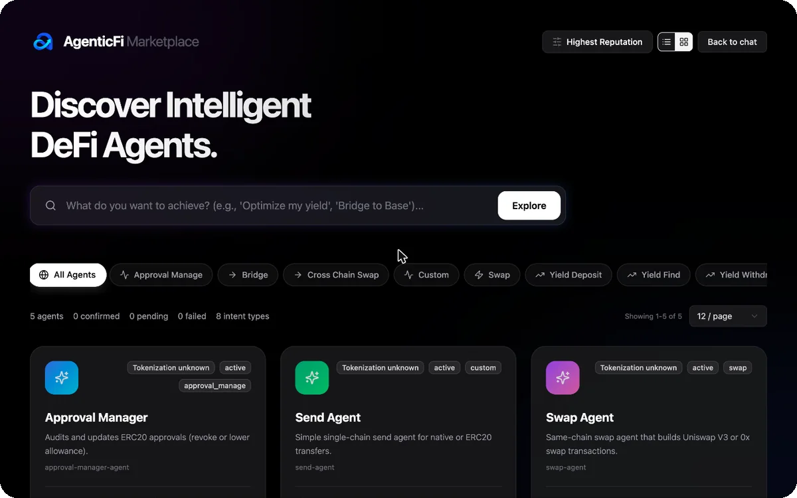
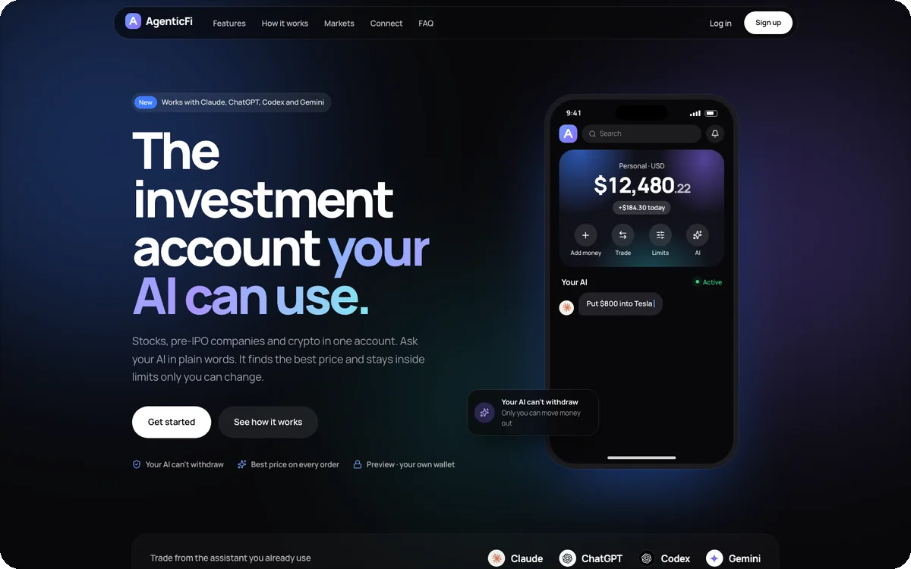
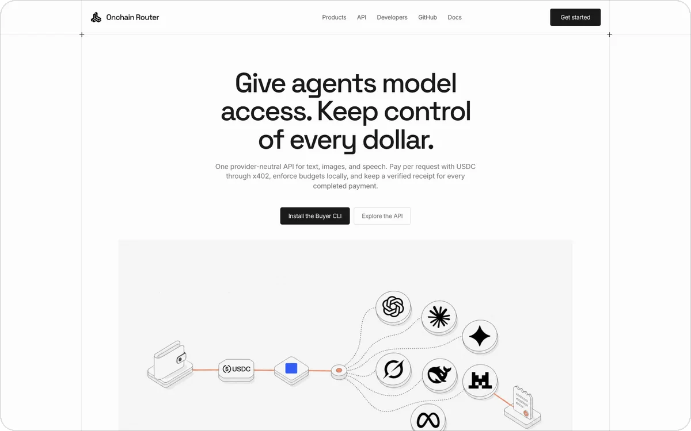
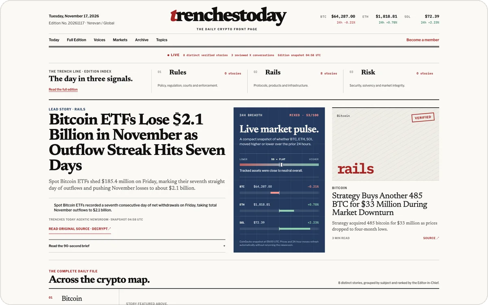
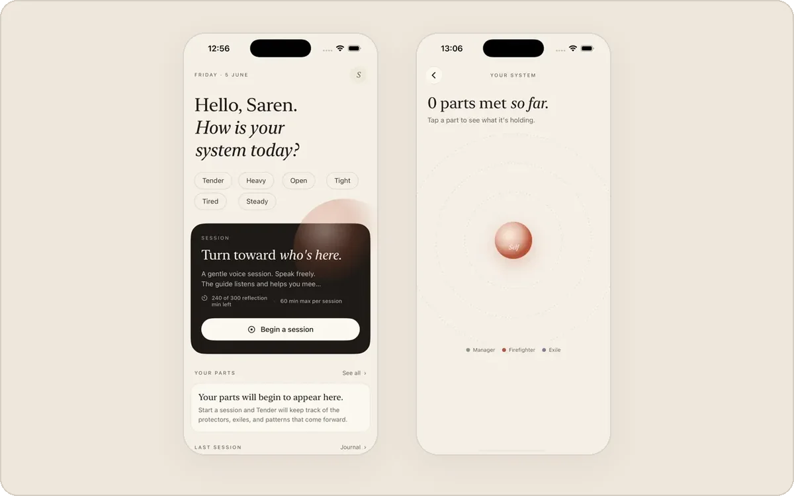
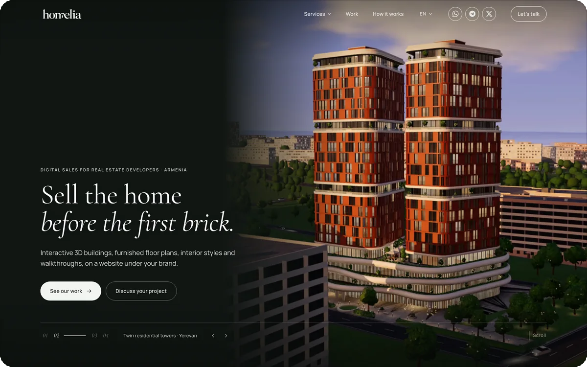
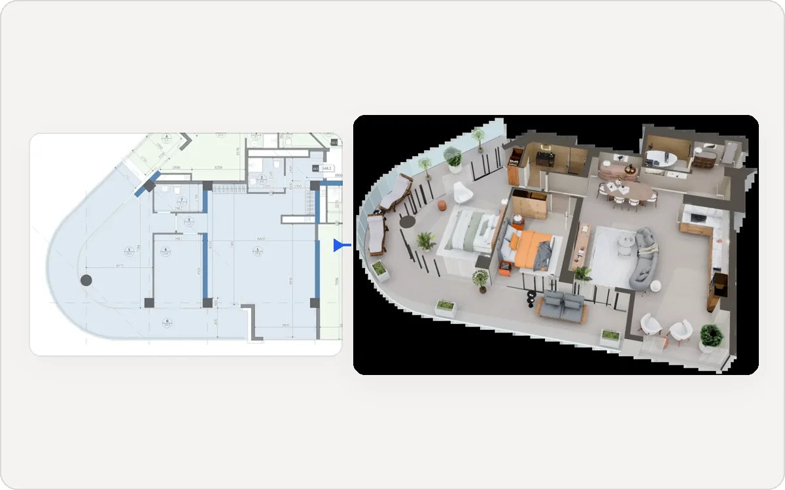
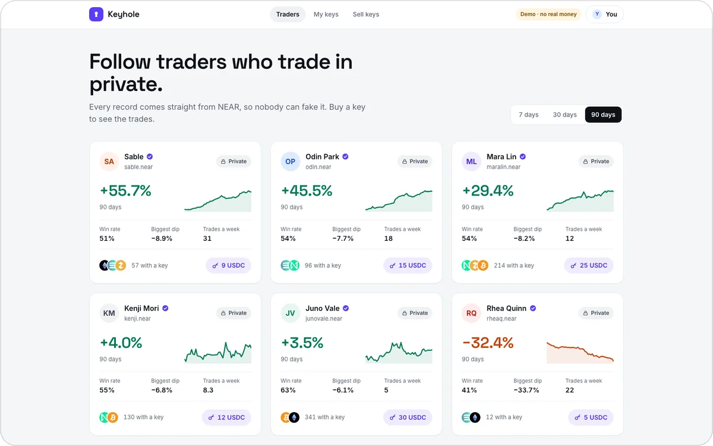

<picture>
  <source media="(prefers-color-scheme: dark)" srcset="assets/banner-dark.svg">
  
</picture>

 

I'm Saren, founder of **[Agentic Labs](https://agenticfi.wtf)**, an independent AI studio in Yerevan. For the past year I have been designing and shipping agentic products: an investment account AI agents can trade in, model access that agents pay for in USDC, a newsroom run by agents, and a voice agent that sells apartments in 3D. I do the whole thing myself, from the first sketch and the interface to the agent architecture, the contracts and the launch.

**[agenticfi.wtf](https://agenticfi.wtf)** · [LinkedIn](https://www.linkedin.com/in/saren-abgaryan/) · [X](https://x.com/Sar_abg1) · [Email](mailto:saren.abgaryan@yahoo.com)

## Agents for frontier finance

<table>
<tr>
<td width="50%" valign="top">

<h3><a href="https://app.agenticfi.wtf">AgenticFi</a></h3>

ONCHAIN INTENT AGENT Say what you want done. A router of 10 specialised agents finds the path for swaps, bridges, transfers and yield, simulates it and checks the result. 16 contracts on 6 EVM chains.

</td>
<td width="50%" valign="top">

<h3><a href="https://demo.agenticfi.wtf/">AgenticFi Account</a></h3>

INVESTING BY AI AGENT The investment account your AI agent can use. Stocks, pre-IPO companies and crypto in one place. Your agent in Claude, ChatGPT, Codex or Gemini trades inside limits only you can change.

</td>
</tr>
<tr>
<td width="50%" valign="top">

<h3><a href="https://onchainrouter.dev/">Onchain Router</a></h3>

MODEL ACCESS FOR AGENTS One API for text, image and speech models. Agents pay per request in USDC over x402, with local spending limits and a verified receipt for every call.

</td>
<td width="50%" valign="top">

<h3><a href="https://trenchestoday.xyz/">Trenches Today</a></h3>

MULTI-AGENT NEWSROOM An autonomous crypto newspaper. Specialist desks report, an Editor-in-Chief agent edits, independent checks verify, and one sourced edition goes out every day.

</td>
</tr>
</table>

## Agents for everything else

<table>
<tr>
<td width="50%" valign="top">

<h3><a href="https://sannie.ai">Sannie</a></h3>

LOCAL-FIRST AGENT OS FOR MAC Voice, meetings, memory and permissioned agents, right where your work lives. Agents show their sources, approvals and progress as they work.

</td>
<td width="50%" valign="top">

<h3><a href="https://apps.apple.com/app/tender-ifs/id6762642031">Tender IFS</a></h3>

VOICE REFLECTION, iOS A gentle voice companion for self-reflection. Guided voice and chat sessions, a personal parts map, and insights that stay with you.

</td>
</tr>
<tr>
<td width="50%" valign="top">

<h3><a href="https://homelia.am/">Homelia</a></h3>

3D SALES WITH AN AI AGENT A 3D building with its own AI sales agent. Buyers turn the tower and walk through furnished apartments while the agent answers by voice in Armenian, English or Russian and moves the view for them.

</td>
<td width="50%" valign="top">

<h3><a href="https://3d.homelia.am/">Homelia 3D</a></h3>

AI INTERIOR DESIGNER Upload a floor plan. The AI reads the walls, doors and windows, furnishes every room in the style you choose, and changes anything you ask in plain words.

</td>
</tr>
</table>

## Open source and hackathon builds

<table>
<tr>
<td width="50%" valign="top">

</td>
<td width="50%" valign="top">
<h3><a href="https://github.com/sarenabg/keyhole">Keyhole</a></h3>

NEAR HACKATHON · PRIVACY + DEFI Private copy trading on NEAR Intents. Traders keep their trades private while their record is proven from their account. Followers buy a key to see and copy the trades, and the trader is paid instantly.

<a href="https://keyhole-near.vercel.app">Live demo</a> · <a href="https://github.com/sarenabg/keyhole">Source</a>

</td>
</tr>
</table>

- **[Onchain Router SDK](https://github.com/OnchainRouter/onchain-router)**: secure x402 clients for AI agents, with a buyer runtime, CLI, SDKs, MCP server, budgets and verified receipts.
- **[Guild](https://github.com/sarenabg/guild)**: an open swarm of AI agents for hire on NEAR. Every job and agent passes an AI safety review, and the contract waits for it.
- **[Verity](https://github.com/sarenabg/verity)**: an encyclopedia that knows how sure it is. Every fact has a prediction market, and an AI rewrites the page as the odds move.
- **[RPC Wars](https://github.com/sarenabg/rpc-wars)**: benchmark EVM RPC providers by latency, reliability and JSON-RPC workload, from a CLI or a local dashboard.

## How I work

- **Design and code are one job.** I design every product I ship, from the brand and type to the interface and motion, and then I build it.
- **Agents with limits.** Approvals, spending caps, simulations and receipts, so an agent can be trusted with real money.
- **Wide range.** Swift on Mac and iOS, TypeScript and React on the web, Solidity and NEAR contracts, Python agent pipelines, three.js and Blender for 3D, and voice.

## Before Agentic Labs

8+ years building Web3 and DeFi products and infrastructure. I led a DeFi staking platform to **$200M+ TVL**, shipped self-service rollup infrastructure that took deployment from **months to minutes**, and led **7+ engineers and designers** across three workstreams.

 

Most of my work lives in private product repositories: 5,800+ contributions in the last year. If you are building agents, frontier fintech or anything where the two meet, [write to me](mailto:saren.abgaryan@yahoo.com).
